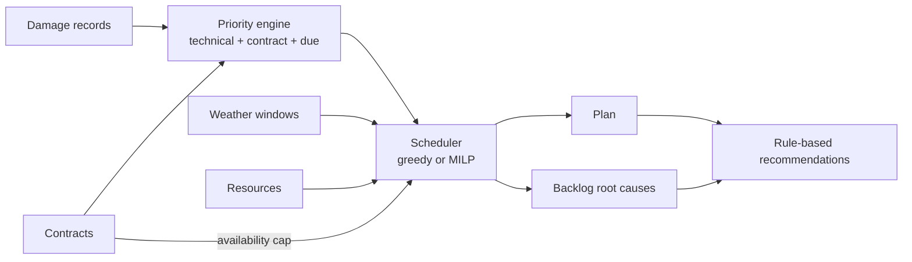

# Wind Maintenance Intelligence

Decision support for wind turbine maintenance: **which turbine first, what can
actually be scheduled, and why the rest is in the backlog.**

The platform combines inspection damage data, customer contracts, weather
windows and crew capacity in one decision chain:



It is a **decision-support prototype**, not a predictive-maintenance product:
it ranks and schedules known damage, it does not predict failures, and the
engineer keeps the decision. Türkçe özet: [README.tr.md](README.tr.md).

## What it does

| Question | Module | Method |
|---|---|---|
| Which turbine matters most? | `scoring` | Weighted multi-criteria score; critical turbines always rank first |
| Why this score? | `scoring` | The three weighted contributions are exported and sum exactly to the score |
| When can it be done? | `scheduling`, `optimizer` | Hard constraints: weather, customer availability cap, crew capacity. Greedy baseline and exact MILP (HiGHS) |
| Why is it not scheduled? | `backlog` | Every slot is checked against every constraint; primary blocker and *near miss* per turbine |
| What should I do about it? | `recommendations` | Rule-based text generated from the plan — no hard-coded sites, no ML |
| Can I trust the ranking? | `sensitivity` | Monte-Carlo rank stability under weight uncertainty |

## Quick start

```bash
git clone <your-repo-url> && cd wind-maintenance-intelligence
python -m venv .venv && source .venv/bin/activate      # Windows: .venv\Scripts\activate
pip install -e ".[dashboard,dev]"

windmaint run                      # 150-turbine fleet: score, schedule, write outputs/
windmaint run --scheduler milp     # same, with the optimiser
windmaint compare                  # greedy vs MILP
windmaint sensitivity              # how stable is the ranking?
windmaint validate                 # check the input files
windmaint --data data/sample run   # the 5-turbine minimal case
streamlit run dashboard/app.py     # interactive dashboard
pytest                             # test suite
```

Use your own data with `windmaint --data path/to/folder run`; the expected files
are described in [docs/data-dictionary.md](docs/data-dictionary.md).

## Data sets

| Folder | Content | Purpose |
|---|---|---|
| `data/fleet` | 150 turbines, 12 sites, 5 customers, 6 crews, 126 damages, 10 working days of weather | Realistic scale; default everywhere |
| `data/sample` | 5 turbines, 4 sites, 3 customers, 3 days | Small enough to check every number by hand |

Both are **synthetic**. The fleet is produced by a seeded generator
(`python scripts/generate_fleet.py`, options for seed, start date, number of
days and damage share), with weather that is correlated in time and within a
region. Site codes and coordinates are invented and only roughly placed in
windy regions of Türkiye.

## The fleet case

64 of the 150 turbines carry open damage records and become maintenance jobs;
18 of them are critical. Two working weeks are planned (20 slots).

| Scheduler | Scheduled | Backlog | Critical in backlog | Late | Plan cost |
|---|---|---|---|---|---|
| Greedy | 38 / 64 | 26 | 3 | 1 | 337.0 |
| MILP | 38 / 64 | 26 | 2 | 0 | 295.7 |

What the run shows:

* **The contract cap is the bottleneck, not the crews.** The contract cap is the
  primary blocker for 19 of the 26 backlog turbines and weather for 7; crews
  are 63 % utilised. Customer B alone (40 turbines, one already down, cap of one
  outage per day) has 14 of its 24 jobs waiting.
* **The optimiser does not schedule more jobs here, it schedules the right
  ones.** Both plans hold 38 jobs because the caps limit throughput. Greedy
  leaves one schedulable critical turbine in the backlog and plans another four
  days after its due date; the optimiser places 8 jobs differently and gets
  every schedulable critical turbine in on time.
* **Two critical turbines cannot be scheduled by any plan.** Customer E's
  outage budget is zero (`floor(12 × 3 %) = 0`), which also leaves the crew
  based in that region without work. This needs a customer decision
  (or `contracts.critical_override`), not a better algorithm.
* **Ranks are bands, not an exact order.** Under plausible weight changes the
  exact ranking of 64 turbines is essentially never reproduced, but on average
  94 % of the top ten stays in the top ten and a turbine moves 1.5 places.

## The minimal case

`data/sample` shows the same mechanics with numbers that fit on one screen.

```
Rank Turbine  Category      Score  = technical + contract + due
  1  T5       Critical      0.746    0.492       0.104      0.150   -> backlog
  2  T2       Critical      0.685    0.396       0.229      0.060   -> 15.04 Morning
  3  T4       Critical      0.534    0.384       0.000      0.150   -> backlog
  4  T3       Non-Critical  0.527    0.264       0.229      0.034   -> 16.04 Morning
  5  T1       Non-Critical  0.457    0.228       0.229      0.000   -> backlog
```

| Turbine | Primary blocker | Nearest miss | Actionable? |
|---|---|---|---|
| T5 | Contract cap (6 of 6 slots) | 15.04 Morning: only the cap blocked it | Yes — customer Y has no outage budget left: floor(80 × 2 %) = 1 allowed, 1 already down |
| T4 | Weather (6 of 6 slots) | — | No — wait for the forecast |
| T1 | Weather (5 of 6 slots) | 15.04 Morning: only the cap blocked it | Yes — T2 used the customer's single slot that day |

Greedy gives T2 the 15.04 slot. That was the only workable day for T1, while T2
had other options. The optimiser moves T2 and T3 one day later (both still
inside their due dates) and fits T1 in: 3 of 5 jobs instead of 2
(plan cost 45.7 → 42.4).

## Model

### Priority score

```
Technical_Score = 2·Max_Severity + 1.5·Increasing_Count + 1·Total_Damage_Count + 3·Critical_Count
Contract_Score  = Priority_Boost · (1 + Contract_Month / Contract_Total_Months)
Due_Score       = 1 / Recommended_Due_Days            (from planning_rules.csv)

Final_Priority_Score = 0.60·norm(Technical) + 0.25·norm(Contract) + 0.15·norm(Due)
```

* **Normalisation** uses fixed reference bounds by default, so a turbine's
  score does not change when other turbines enter or leave the fleet. The
  original min–max behaviour is available (`normalization.method: minmax`).
* **Ranking** is tiered: every *Critical* turbine (a damage with severity ≥ 4)
  ranks above every *Non-Critical* one; the score orders turbines inside a
  tier. Contract pressure can therefore never push a non-critical turbine ahead
  of a critical one.
* The score is a **relative priority index**. It is not a failure probability.
* The weights are engineering judgement; `windmaint sensitivity` shows how much
  the ranking depends on them.

### Constraints

| Constraint | Rule | Source |
|---|---|---|
| Weather | The (site, day, window) slot must be workable | `weather.csv` flag, or wind / gust / rain / temperature limits |
| Contract | Jobs per customer per day ≤ `floor(Total_Turbines · (1 − target)) − Current_Down_Turbines` | `customer_contracts.csv` |
| Resource | Jobs per resource per day ≤ `Daily_Capacity`; the resource must cover the turbine's region | `resources.csv` |

Weather is a feasibility constraint only; it never enters the score. Among the
crews that can take a job, the most dedicated one (fewest regions covered) is
used first, which keeps multi-region and roaming crews free.

### Schedulers

* **Greedy** — jobs in priority order, each takes its first feasible slot.
  Transparent and fast; the default.
* **MILP** — binary `x[job, slot, resource]`, minimising
  `Σ weight · (delay days + lateness penalty)` for scheduled jobs plus a backlog
  cost for unscheduled ones. The backlog cost of a job is always higher than
  its worst slot in the horizon, so "late" is preferred over "not at all".
  Solved with HiGHS through SciPy (no extra solver to install); the fleet case
  solves in well under a second.

Both are scored with the same cost function, so they can be compared directly.

## Dashboard

`streamlit run dashboard/app.py` runs the engine live. The sidebar holds the
data set, the scenario controls (scheduler, horizon, weights, normalisation,
critical override, weather source) and view filters (customer, region, site,
category).

| Page | Shows |
|---|---|
| Overview | KPIs, highest priorities with real score contributions, all jobs, workload by site |
| Maintenance plan | Jobs per day, crew dispatch table, day detail, resource utilisation, Excel export |
| Backlog root causes | Blocked slots by site and constraint, primary blockers, backlog by customer |
| Recommendations | Escalate / Action / On track, each with reasons and next steps; CSV export |
| Turbine detail | Damage records, score contributions, recommendation and slot-by-slot check for one turbine |
| Contracts | Outage budget, contract period elapsed, planned peak per customer |
| Site map | Site status, workload and snapshot weather |
| Scenario lab | Greedy vs MILP, rank stability under weight uncertainty |
| Data quality | Validation issues, weather flag vs. limit conflicts, raw tables |

## Configuration

All numbers live in [`config/default.yaml`](config/default.yaml): technical and
final weights, critical threshold, normalisation, planning horizon, scheduler,
MILP penalties, weather limits. Pass a partial file with `--config`.

## Weather forecast (optional)

```bash
windmaint --data data/my_fleet fetch-weather --days 5
```

builds `weather.csv` from the free [Open-Meteo](https://open-meteo.com/) API
(no key) for the coordinates in `site_locations.csv`: hourly wind at 80 m,
gusts, precipitation probability and temperature, aggregated to the worst hour
of each window and turned into `Workable` with the configured limits.

## Project layout

```
config/default.yaml        all tunable parameters
data/fleet/                synthetic 150-turbine fleet (9 CSV files)
data/sample/               5-turbine minimal case
scripts/generate_fleet.py  seeded generator for data/fleet
src/windmaint/
    io.py                  loading, delimiter/encoding detection, validation
    contracts.py           contract time factor, availability budget
    scoring.py             metrics, scores, contributions, ranking
    scheduling.py          problem model, constraint check, cost, greedy
    optimizer.py           MILP scheduler
    backlog.py             root-cause analytics
    recommendations.py     rule-based explanations
    sensitivity.py         weight-uncertainty analysis
    weather.py             workability rules, Open-Meteo client
    analytics.py           filters and aggregations for the dashboard
    pipeline.py            run(), compare_schedulers()
    export.py              Excel + CSV output
    cli.py                 windmaint command
dashboard/                 Streamlit app (app.py, components.py, views/)
tests/                     pytest suite
docs/                      data dictionary, design review
```

## Limitations

* All data is synthetic. The fleet has a realistic size and structure, but the
  results say how the model behaves, not how a real fleet behaves.
* Weights and thresholds are not calibrated against expert rankings or outcomes.
* The availability cap counts turbines per day, not turbine-hours, and treats a
  planned repair like any other downtime. In the fleet case this single
  assumption decides most of the backlog; check the contract definition before
  relying on it.
* Every job takes one slot; there are no durations, travel times or skills yet.
* No cost of delay: production loss, energy price and penalties are not modelled.
* The recommendation layer is rule-based. There is no machine learning.

[docs/design-review.tr.md](docs/design-review.tr.md) discusses these points and
the road to a real pilot in detail (Turkish).

## Roadmap

1. Calibrate weights from engineers' rankings of real cases.
2. Availability budget in turbine-hours; job durations and skills.
3. Persist runs (SQLite/PostgreSQL) for backlog ageing and audit.
4. Pilot in shadow mode on a real 100–150 turbine fleet for one maintenance season.
5. Damage-progression model once enough dated inspection history exists.

## License

MIT — see [LICENSE](LICENSE).
